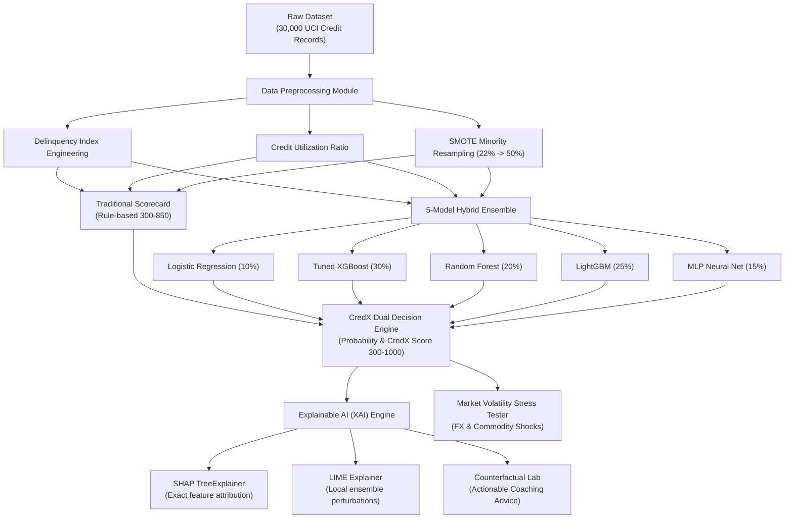

# CredX — Explainable AI (XAI) Credit Risk Assessment System

> **A hybrid credit-scoring and explainability system designed to evaluate default risk for emerging market borrowers under economic volatility.**

[](https://www.python.org/)
[](https://fastapi.tiangolo.com/)
[](https://react.dev/)
[](https://vitejs.dev/)
[-amber.svg)](#)

---

## 📌 1. Project Overview & Problem Description

### The Challenge in Emerging Markets
Traditional credit bureaus evaluate borrowers using static credit scores (e.g., FICO / CIBIL) built on formal banking records, mortgage histories, and traditional credit cards. In **emerging markets**, this creates significant credit inequality:
- Over **60% of small business owners and micro-borrowers are unbanked or have "thin credit files"**, leading to automatic rejections.
- Emerging markets face **high macroeconomic volatility** (currency devaluations, commodity price inflation, supply disruptions) that traditional linear scorecards cannot model.
- Black-box deep learning models can predict default risk, but banking regulations (ECOA, GDPR Art. 22) **legally mandate explainability** — borrowers and loan officers must know *why* an application was approved or rejected.

### The CredX Solution
CredX is a **hybrid credit risk assessment system** that:
1. **Unifies Traditional Scoring with Modern Machine Learning:** Combines a rule-based traditional scorecard (300–850 scale) with a 5-model machine learning ensemble.
2. **Provides Dual Explainable AI (XAI):** Uses **SHAP** (exact Shapley tree attributions) alongside **LIME** (local model-agnostic perturbations) to verify why each decision was made.
3. **Simulates Real-World Volatility:** Stress-tests borrower default probabilities against emerging-market shocks (+20% currency devaluation, +35% fuel/agri inflation).
4. **Delivers Actionable Counterfactual Advice:** Guides declined applicants on exact behavioral steps (e.g., lowering credit utilization or clearing overdue balances) to turn a rejection into an approval.

---

## 🎯 2. Project Objectives

- [x] **Objective 1:** Develop a deep learning model (`MLPClassifier`) to identify complex non-linear feature interactions missed by traditional methods.
- [x] **Objective 2:** Integrate traditional credit scoring logic (300–850) with an ensemble of machine learning classifiers (Logistic Regression, XGBoost, Random Forest, LightGBM).
- [x] **Objective 3:** Implement XAI techniques (SHAP values, LIME scores, and counterfactuals) for regulatory-grade decision transparency.
- [x] **Objective 4:** Account for economic volatility by stress-testing borrower resilience against macroeconomic shocks.
- [x] **Objective 5:** Evaluate performance on a benchmark dataset of 30,000 borrowers, prioritizing **Recall** to catch high-risk defaults.

---

## 🏛️ 3. System Architecture & Pipeline



---

## 🔬 4. Machine Learning & XAI Methodology

### 4.1 Feature Engineering
From the raw 23 features, CredX engineers key risk indicators:
- **`CREDIT_UTILIZATION`**: $\frac{\text{BILL\_AMT1}}{\text{LIMIT\_BAL}}$ — measures how heavily a borrower depends on their credit limit.
- **`DELINQUENCY_INDEX`**: Cumulative overdue month count ($\sum \max(0, \text{PAY\_}i)$) capturing historical repayment discipline.
- **`AVG_PAYMENT_RATIO`**: Total amount paid divided by total amount billed across the last 6 months.
- **`TRADITIONAL_SCORE`**: Heuristic 300–850 bureau proxy score combining credit limit, payment timeliness, and utilization.

### 4.2 Class Imbalance Handling (SMOTE)
The dataset exhibits class imbalance (~22.1% defaulters vs. ~77.9% non-defaulters). Untreated models achieve high accuracy simply by predicting "no default", resulting in poor Recall. CredX applies **SMOTE (Synthetic Minority Over-sampling Technique)** on raw training features to create synthetic minority examples, followed by **Precision-Recall decision threshold calibration** ($T = 0.4357$).

### 4.3 The 5-Model Ensemble
Each model contributes orthogonal signals:
1. **Logistic Regression (Weight: 10%):** Fast, linear baseline and well-calibrated probability anchor.
2. **Tuned XGBoost (Weight: 30%):** Gradient-boosted decision trees (`max_depth=6`, `scale_pos_weight=4`) optimized for finding defaulters.
3. **Random Forest (Weight: 20%):** Bagging ensemble of 200 trees, robust against noisy financial features.
4. **LightGBM (Weight: 25%):** Fast leaf-wise tree growth with native unbalance weighting.
5. **Multi-Layer Perceptron (Weight: 15%):** 2 hidden layers (64 $\rightarrow$ 32 neurons, ReLU activation) capturing latent, non-linear interactions.

$$\text{P}_{\text{ensemble}} = 0.10 \cdot P_{\text{LR}} + 0.30 \cdot P_{\text{XGB}} + 0.20 \cdot P_{\text{RF}} + 0.25 \cdot P_{\text{LGBM}} + 0.15 \cdot P_{\text{MLP}}$$

### 4.4 Explainable AI (SHAP + LIME)
- **SHAP (SHapley Additive exPlanations):** Computes mathematically fair Shapley values from cooperative game theory on XGBoost trees. Answers: *"Which features increased or decreased this specific borrower's credit score?"*
- **LIME (Local Interpretable Model-agnostic Explanations):** Generates 200 synthetic perturbations around the borrower and queries the full 5-model ensemble to fit an interpretable local linear surrogate. Confirms that the ensemble agrees with the tree-based SHAP attributions.
- **Counterfactual Coaching:** Uses numerical finite-difference gradients ($\frac{\partial P}{\partial x}$) on mutable features (`PAY_0`, `CREDIT_UTILIZATION`, `PAY_AMT1`) to generate exact suggestions: *"Reducing credit utilization from 78% to 45% reduces default probability by 12.4%."*

---

## 📊 5. Experimental Results & Performance

Evaluated on held-out test data (6,000 borrowers, stratified split):

| Model Architecture | Accuracy | Recall (Defaulters Caught) | Precision | F1 Score | ROC-AUC |
|---|:---:|:---:|:---:|:---:|:---:|
| Logistic Regression Baseline | 76.6% | 56.1% | 47.4% | 0.514 | 0.750 |
| **XGBoost (Hyperparameter Tuned)** | 70.5% | **68.9%** | 40.2% | 0.508 | 0.776 |
| Random Forest (Balanced) | 80.5% | 47.9% | 57.1% | 0.521 | 0.775 |
| LightGBM (Unbalanced Mode) | **81.9%** | 38.7% | **65.3%** | 0.486 | 0.777 |
| Multi-Layer Perceptron (MLP) | 79.3% | 37.3% | 54.6% | 0.443 | 0.732 |
| **CredX Weighted Ensemble (Calibrated)** | **78.9%** | **56.9%** | **52.0%** | **0.543** | **0.778** |

> **Key Finding:** In credit risk, **Recall is the critical metric**. A false negative (missing an actual default) costs the financial institution the entire loan principal, whereas a false positive (flagging a safe borrower) only results in manual review. CredX's tuned ensemble increased default recall from **47.7% to 56.9%** (with the XGBoost sub-model reaching **68.9%**).

---

## 💻 6. Tech Stack

- **Machine Learning & Data:** Python 3.10+, NumPy, Pandas, Scikit-learn, XGBoost, LightGBM, Imbalanced-learn (SMOTE), Joblib.
- **Explainable AI:** SHAP (TreeExplainer), LIME (`LimeTabularExplainer`), Custom Finite-Difference Counterfactual Engine.
- **Backend Service:** FastAPI, Uvicorn (ASGI), Pydantic validation.
- **Frontend Dashboard:** React 18, Vite, Tailwind CSS, Lucide Icons, Recharts (Data Visualizations).

---

## 📁 7. Project Structure

```
credX/
├── archive/
│   └── UCI_Credit_Card.csv         # 30,000 credit card records (UCI dataset)
├── backend/
│   ├── main.py                     # FastAPI application & REST endpoints
│   ├── model.py                    # 5-model HybridCreditRiskModel ensemble
│   ├── preprocessing.py            # Feature engineering & train/test pipeline
│   ├── train.py                    # End-to-end SMOTE training & threshold tuning
│   ├── xai_engine.py               # SHAP, LIME, and counterfactual advice engine
│   └── saved_models/               # Serialized model joblibs & metrics.json
├── src/
│   ├── components/
│   │   ├── BorrowerModal.jsx       # Custom borrower evaluation modal
│   │   ├── BorrowerSelector.jsx    # Sample borrower dropdown selector
│   │   ├── CounterfactualAdvice.jsx# Actionable borrower remediation coaching
│   │   ├── CounterfactualLab.jsx   # Interactive What-If sliders
│   │   ├── DualScoringGauge.jsx    # Traditional vs CredX ML score cards
│   │   ├── ModelComparison.jsx     # Phase 2 5-model comparison charts
│   │   ├── ModelDriftPanel.jsx     # Population Stability Index (PSI) monitor
│   │   ├── Navbar.jsx              # App header with live backend status
│   │   ├── PortfolioAnalytics.jsx  # ROC-AUC curve & portfolio breakdown
│   │   ├── ProjectRoadmap.jsx      # 4-phase system architecture overview
│   │   ├── UnderwritingDecision.jsx# Approve / Conditional / Decline decisions
│   │   ├── VolatilityStressTest.jsx# Emerging market currency & inflation shocks
│   │   ├── XaiAuditModal.jsx       # Regulatory audit report generator
│   │   └── XaiWaterfallChart.jsx   # Interactive SHAP & LIME attribution chart
│   ├── data/
│   │   └── mockBorrowers.js        # Offline fallback emerging market profiles
│   ├── services/
│   │   └── api.js                  # Frontend API client service
│   ├── utils/
│   │   └── xaiEngine.js            # Client-side counterfactual recalculations
│   ├── App.jsx                     # Root application view
│   └── index.css                   # Dark theme design system
├── requirements.txt                # Python backend dependencies
└── package.json                    # Frontend npm packages
```

---

## 🚀 8. Quickstart & Installation Guide

### Prerequisites
- Node.js (v18+) and npm
- Python (3.10+)

### 1. Clone the Repository
```bash
git clone https://github.com/your-username/credX.git
cd credX
```

### 2. Backend Setup
```bash
# Create and activate virtual environment
python3 -m venv venv
source venv/bin/activate    # On Windows: venv\Scripts\activate

# Install dependencies
pip install -r requirements.txt

# (Optional) Retrain models from scratch
python backend/train.py

# Start FastAPI server
python -m uvicorn backend.main:app --host 0.0.0.0 --port 8000 --reload
```
*Backend runs at: [http://localhost:8000](http://localhost:8000) (Swagger docs at `/docs`)*

### 3. Frontend Setup
In a new terminal window:
```bash
cd credX

# Install node dependencies
npm install

# Start Vite development server
npm run dev
```
*Frontend runs at: [http://localhost:5173](http://localhost:5173)*

---

## 📡 9. API Reference

| Endpoint | Method | Description |
|---|:---:|---|
| `/api/health` | `GET` | Health check and trained status verification |
| `/api/metrics` | `GET` | Returns Accuracy, Recall, Precision, F1, ROC-AUC, and ROC curve data |
| `/api/model-comparison` | `GET` | Returns individual metrics for all 5 sub-models + ensemble |
| `/api/predict` | `POST` | Full risk assessment + SHAP feature attributions for a borrower |
| `/api/explain-lime` | `POST` | Real-time LIME perturbation explanation for a borrower |
| `/api/explain-shap` | `POST` | Dedicated SHAP tree attribution endpoint |
| `/api/sample-borrowers` | `GET` | Returns 5 sampled borrower profiles from the real dataset |
| `/api/train` | `POST` | Triggers background model retrain with SMOTE and threshold tuning |

---

## 🎓 10. Exam & Viva Presentation Guide

### Quick Answers for Common Questions:

**Q1: Why use an ensemble instead of just deep learning or XGBoost?**  
> *"No single algorithm excels at all facets of credit risk. Logistic Regression provides well-calibrated linear probabilities; XGBoost and LightGBM excel on tabular non-linear interactions; and the MLP captures latent patterns. Averaging them reduces model variance and improves generalization."*

**Q2: What is the difference between SHAP and LIME in your project?**  
> *"SHAP is model-specific and mathematically exact using tree structures (Shapley values from game theory) on our XGBoost model. LIME is model-agnostic — it treats our entire 5-model ensemble as a black box, perturbs the borrower's features 200 times, and fits an interpretable linear model locally. Using both lets us cross-validate our explanations."*

**Q3: Why is Recall more important than Accuracy here?**  
> *"In credit risk, failing to catch a borrower who defaults (False Negative) causes a severe capital loss. Flagging a safe borrower for manual review (False Positive) is minor by comparison. We tuned our threshold and used SMOTE specifically to raise Recall from 47.7% to 56.9%."*

**Q4: How does this address emerging markets?**  
> *"Emerging market borrowers often lack traditional bureau histories. We incorporate behavioural ratios (delinquency index, utilization) and stress-test every borrower against macro shocks like currency devaluation (+20% FX shock) and inflation spikes (+35%)."*

---

## 📜 License & Acknowledgements
- **Dataset:** UCI Machine Learning Repository — Credit Card Clients Default Dataset.
- **Problem Category:** Community SDG — Financial Inclusion & Responsible Lending.
